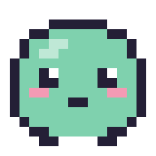

<p align="center"></p>

# Buddy

A small pixel-art desk companion for Windows and Linux, and a mentor. Click it to open a chat bubble:

- **local model** (Ollama) for quick answers grounded on the notes of one Obsidian project folder (read-only);
- **Claude** (Claude Code CLI) for real tasks, in the same thread, with permission prompts answered from the bubble;
- **mentor**: its main goal is to help you grow as a developer and as a person, not just to make work easier.

## Requirements

- Windows 10/11 or Linux (developed on Ubuntu with GNOME), .NET 10 SDK
- [Ollama](https://ollama.com) running locally, with the configured model pulled (`ollama pull llama3.2:3b`)
- Claude Code CLI logged in (`claude` then `/login` in a terminal)
- For dictation: a Whisper ggml model, e.g. `ggml-small.bin` from `huggingface.co/ggerganov/whisper.cpp`, in
  `<data>/models/` (or set its path in the settings)

`<data>` below is the per-user folder: `%APPDATA%\Buddy` on Windows, `~/.config/Buddy` on Linux.

The UI is [Avalonia](https://avaloniaui.net), the same on both systems. What differs per OS lives in
`src/Buddy.App/Platform/`:

| | Windows | Linux |
|---|---|---|
| Tray icon and notifications | WinForms `NotifyIcon` (balloons/toasts) | Avalonia tray icon (StatusNotifierItem; on GNOME it needs the AppIndicator extension, enabled by default on Ubuntu) and `notify-send` |
| Global shortcut | Registered by the app (`Assistente → Scorciatoia globale`) | Set in the desktop: bind a shortcut to `Buddy.App --hotkey` (see below) |
| Idle time | `GetLastInputInfo` | GNOME idle monitor over D-Bus (`gdbus`); X11 screensaver extension on X11 sessions |
| "Do not disturb" | Microphone in use by another app, full-screen app or presentation, Windows focus assist | Microphone in use by another app (PipeWire, `pw-dump`), GNOME "do not disturb". Full-screen apps are not detected |
| Microphone | WinMM (NAudio) | `pw-record` (PipeWire) or `arecord` |
| Start at login | Registry `Run` key | `~/.config/autostart/buddy.desktop` |

On Linux the windows run through X11 (XWayland on a Wayland session), which lets the pet place itself and stay on
top like on Windows.

**Global shortcut on Linux.** Wayland does not let apps grab keys, so the desktop does it: in GNOME, Settings →
Keyboard → Keyboard Shortcuts → Custom Shortcuts → add one with command `/path/to/Buddy.App --hotkey` and the keys
you like (e.g. Ctrl+Alt+B). Only one buddy runs at a time: a second launch hands its request to the running one, so
`--hotkey` opens the chat with the clipboard attached, and launching the app again just opens the chat.

## First run

A short wizard asks your name, the buddy's name and **personality** (calm mentor, motivating coach, ironic friend,
direct and challenging, old sage, or your own description), your **interests** outside work (music, films, chess…,
used for off-topic chats that keep you company) and the journal folder. It can be repeated from
Impostazioni → Mentore e voce.

## Mentor

| | |
|---|---|
| Check-in / check-out | Morning: priorities from the vault and one question to plan with intention. Evening: what went well, what blocked you, what you'd change, mood 1-5. |
| Before delegating | When you press a task button (e.g. `/lavora ID`), it first asks how *you* would approach it; Claude then reviews your approach before starting. |
| Pills | Knowledge pills (e.g. TCP vs UDP), method tips, "explain it to me" questions, everyday-approach ideas, chosen from your profile and, about 2 times out of 3, from what is behind the task you are on (branch and changed files); never repeated (`Pillole.md`). |
| Spaced review | A quick recall question on a pill seen days ago (after 2, 7, 21, 60 days; a wrong or partial answer brings it back after 2). Claude grades the answer (✓ / ~ / ✗), explains what was missing and logs the result in `Pillole.md`. Nothing is asked when no pill is due. |
| Chats | Growth questions (books, what you are learning), off-topic questions on your interests just for company, and questions to get to know you better. When a task moves to *Da controllare* the mentor asks one question to learn from it while it is fresh. Under an open question, **🤔 Spiegamelo tu** gets an explanation instead of another question. |
| Profile | `Profilo.md` keeps goals, reading, learning, interests, strengths, things to improve and a **personal profile** (motivation, work and learning style, how you handle stress and feedback). Written from your answers as dated hypotheses with the evidence, never diagnoses — yours to read and correct. |
| Check-out and goals | The evening check-out comes with a **draft of the day** already filled in (tasks closed or in review, commits, the pill, hours at the PC, chats) to correct. `/obiettivi` keeps 2-3 **quarter goals** in Profilo.md; the weekly retro measures the week against them. |
| Breaks and focus | A break suggestion after long continuous activity at the PC; `/focus [min]` silences the mentor and asks how it went. |
| Weekly retro | On the chosen day Claude writes `Retro/<year>-W<week>.md` from the diary, the vault and your commits, with one strength and one habit to work on. |
| Trends | The buddy counts, per week, active hours at the PC, focus blocks, check-ins, pills, reviews, chats, approaches and tasks delegated (/lavora) or done with a guide (/guidami): after three delegated in a week it suggests doing the next with /guidami (`/andamento` shows the last 4 weeks; `/competenze` the skills map from the pills and their reviews). The retro also proposes a **weekly challenge**, a small practical exercise on your code, and checks the next week whether you did it. The retro adds a row to `Andamento.md` (average mood, hours, focus, reviews, whether last week's habit was kept) and compares the week with the previous ones. |
| Do not disturb | The mentor stays quiet while another app uses the microphone (a call), an app is full screen or presenting, or "do not disturb" is on (see the table above for what each system detects); due messages wait until you are free. Pills, reviews and friendly chats also wait until the chat has been quiet for a while after you worked with Claude or the local model (20 minutes by default, Impostazioni → Mentore). |

Your answers are written by Claude (one-shot `claude -p` with a cheap model) into the journal folder only: writing
elsewhere is denied by the CLI. Commands: `/checkin`, `/checkout`, `/pillola`, `/ripasso`, `/chiacchiera`, `/retro`,
`/focus`, `/andamento`, `/salta`, `/mentore`.

## Voice

🎤 in the bubble: click to talk, click again to stop; the text is transcribed **locally** with Whisper and put in the
input box to check before sending. Nothing leaves the PC.

## Configuration

Right click on the pet → **Impostazioni…** edits everything below and restarts the buddy to apply it:
appearance (name, font, bubble colours with light/dark presets), the character (colours, size, animation speed,
always on top, remembered position, start at login, custom pixel art), models and paths, the local model's
personality (system prompt), Claude tools allowed without asking, and the chat phrases.

**Custom pixel art**: a folder with one PNG per state (`idle`, `think`, `work`, `alert`, `error`), each a horizontal
strip of square frames; `claude-<state>.png` applies only in Claude mode; missing files fall back to the built-in
character. "Esporta modello" writes the built-in frames there as a starting point.

Defaults are in `src/Buddy.App/appsettings.json`. Personal values go in `<data>/appsettings.json` (written by
the settings window), which overrides them. Window position is kept in `<data>/state.json`. Minimal example:

```json
{
  "Buddy": {
    "ProjectPath": "C:\\path\\to\\vault\\project",
    "Claude": { "WorkingDirectory": "C:\\path\\to\\repo" }
  }
}
```

| Setting | Meaning |
|---|---|
| `ProjectPath` | Vault folder the local model reads (never written). Also passed to Claude with `--add-dir`. |
| `AlwaysIncludedNotes` | Notes always added to the local context (default none). |
| `TaskIdPattern` | Regex for task ids; blocks mentioning an id found in the question are added to the context. |
| `MaxContextChars` | Vault text budget for the local model. Bigger = slower first token. |
| `Ollama.Model` / `KeepAlive` | Model and how long it stays loaded. The app preloads it at startup. |
| `Claude.WorkingDirectory` | Folder Claude Code runs in (its CLAUDE.md, skills and settings apply). |
| `Claude.Model` | Optional model alias. |

## Usage

- Click the pet: open/close the bubble. Drag it to move. Right click: menu (chat, project board, new conversation,
  open the project vault in Obsidian, settings, exit).
- In the chat: ↑/↓ recall the messages sent before (kept across restarts); typing `/` suggests the commands and
  skills (↑/↓ to choose, Tab or Enter to complete; a mistyped command is caught instead of going to Claude); while a
  model answers, a strip shows how long it has been working with **■ Ferma**; scrolled up, new text does not pull
  the chat down (**↓ ultimi messaggi**); answers have a copy button and their time; code blocks are highlighted
  per language, with **⧉ Copia**; ↺ starts a new conversation.
  More: **Ctrl+F** searches the conversation; under an answer, *Più semplice / Un esempio / Riassumi* ask the same
  model again; the model button (or `/modello`) picks Claude's or the local model, and the input says what a turn
  usually costs with it (average of your own turns); files of the repo dropped on the chat become `@path` references
  for Claude (Shift while dropping attaches them); **🕘** lists the saved conversations (`<data>/conversations`) and
  reopens one, Claude resuming its session. Running from the sources, a newer build is announced and `/aggiorna`
  rebuilds and restarts on it.
  Also: buttons under some messages run their command (e.g. *Passa a Sonnet*, *Crea la checklist*); `/riprendi` (offered
  at start) tells where you left off: the task of the branch, the last conversation on it (reopen it), changes not
  committed, manual tests to do; `/appunto testo` or **Shift+🎤** puts a line in *To-do Appunti*; `/commit` warns about
  the files you never commit (Impostazioni → *File da non committare*); past the **daily budget** (5 $ by default) the
  buddy offers a lighter model; the model menu has *Scelta automatica* (Haiku for short questions, Opus for /lavora and
  /analisi); `/log` shows the latest warnings and errors.
  And: **Ctrl+ / Ctrl- / Ctrl+0** (or Ctrl+wheel) change the size of the messages; **📌** pins a message in a strip at
  the top; **💾** saves an answer as a note in one of your pages (Pagine/Da Claude by default); **request templates**:
  `/modelli nome = testo` (with `{testo}` for what follows), then `/nome …`; `/modelli` lists them.
- **Bacheca del progetto** (pet or tray menu) — the project window, read from the vault's flow notes:
  - *Panoramica*: one number per step (with what matters: ⏰ overdue reviews, 🔥 P1, 🔓 unblocked, Claude cost),
    what needs attention now, *Stato attuale*, last closed tasks;
  - *Bacheca*: Appunti, Da valutare, Da fare (sorted by priority), In attesa, Da controllare;
  - *Archivio*: Fatti (total Claude cost, reworks) and Rifiutati;
  - *Test manuali*: the checklists in `Test manuali/` (one `.md` per task, `- [ ]` cases), with progress and cases to
    redo; tick a case and it is written to the file as `- [x]` (refused if the note changed meanwhile). *Aggiorna con
    Claude* sends `/test-manuali ID`; a task's side panel links to its checklist; **📄 Esporta in Word** writes a
    .docx with only the cases ticked (by section, with task, date and count) to attach to the card in Jira;
  - *Test web*: the saved browser scripts of the `Test web` note (what they cover, last run ✅/❌, command) and the
    screenshots of the `Test web` folder grouped by task (click to open);
    **▶ Esegui** on a script runs its command (or `npx playwright test <file>`) in the scripts folder named in the
    Scheda progetto or in the Test web note (*Cartella degli script di test*; a relative path is taken from the repo),
    without Claude: live output, ■ stop, the outcome from
    Playwright's summary, and "Ultima esecuzione: <date> ✅ (2/2)" written back in the note. A failed run can be sent
    to Claude (🧠 *Chiedi a Claude*) with the end of its output;
  - *Note*: every vault note, with `[[links]]` between them, editable as a whole (Ctrl+S).
  - *Grafo*: the notes and their links as a graph, like Obsidian's (colour = top folder, size = links; wheel zooms,
    drag pans or moves a note, hover lights up its links, click opens it; options for unlinked notes and links to
    notes not yet created; *Colori per task* groups the notes of each task). *🕸 Grafo* in a note shows it there.
  - **Your pages**: every sub-folder of `Pagine/` in the project folder is a page in the side bar (*＋ Nuova pagina…* creates
    one); its notes are cards, *＋ Nuova nota* writes one by hand (title and markdown), and chat answers can be saved there.
  - More pages: **Settimana** (day by day: commits, tasks closed, Claude spending, mood from the journal; ‹ ›),
    **Costi** (spending per week and per model, tasks by cost), **Decisioni** and **Glossario** (the notes as searchable
    cards, with *Registra decisione* / *Nuovo termine*; for a term, the notes that use it), **PR** (your open pull requests
    on GitHub via `gh`, with CI, review and task).
  - On the board, **drag a card** to another column (Da valutare, Da fare, In attesa, Da controllare: written to the vault;
    appunti, closing and refusing stay with /smista, /chiudi, /rifiuta). **🔔 Ricordamelo…** in a card's panel sets
    `[promemoria:: date]` (also «lunedì», «domani», «+3»): that day the chat brings it back. The panel shows the estimate
    against the real duration and cost.
  - In a note or a checklist **Ctrl+F** finds in the page (↑/↓, Esc); Ctrl+Shift+F is the lists filter. A task's side
    panel shows its **🕒 Cronologia** (board steps, PR, notes and checklists, screenshots, journal days, commits with
    its id). In *Salute del vault* a broken link can be fixed with *Crea la nota* or *Collega a «nota simile»*.
- **💡 Nuove idee** (project window side bar, Ctrl+I): describe what you would like to add; Claude (one-off
  `claude -p` in the vault) or the local model proposes 3/5/8 ideas, given the Scheda, Stato attuale and the items
  already planned, done or rejected. They go straight into To-do Appunti as `- <date> · 💡 idea`; *Togli queste idee*
  takes them back, *Smista ora* sends `/smista`.

  **Tags**: each item can have one, written in the note as `[tag:: bug]` (separate from the project's `[tipo:: …]`
  categories). It shows as a coloured label next to the ID; pick it in the side panel (ticket, feature, bug, analisi,
  miglioria, refactoring, documentazione, supporto, or any other name) and filter the board by tag from the bar above
  the columns.

  Cards show ID, date, title, the "—" remark and chips for Dataview fields (`priorita`, `stima`, `consiglio`,
  `tipo`, `fino`/`rivedere` dates, red when past), 🔁 reworks, PR and cost. Click one for the side panel: details,
  **Claude skill buttons** for its step — 🛠 `/lavora`, 🧭 `/guidami`, 📄 `/analisi`, 🚫 `/rifiuta` (asks the reason),
  🤔 `/valuta`, ✅ `/chiudi` (asks the PR), 🧪 `/test-manuali`, 🌐 `/verifica-web` — sent to Claude in the chat, *Chiedi in chat*, and
  *Modifica* / *Elimina* of the item's markdown. A skill button only appears when the skill is installed
  (`~/.claude/skills` or the project's `.claude/skills`); the flow's skills ship with Buddy (the template's `Skill/` notes)
  and the missing ones are installed in `~/.claude/skills` at startup, never overwriting one already there. The side bar adds an appunto (Ctrl+N, Enter); 🗂 Smista sends
  `/smista`. Shortcuts: Ctrl+1…9 views, **Ctrl+K** finds anything (notes, tasks, pages, saved conversations, chat commands), Ctrl+F search, Esc closes edit → panel → window. It refreshes by itself when
  a note changes; an edit never overwrites a note changed meanwhile (it asks to reload instead).
- **Hide/show**: pet menu → *Nascondi Buddy*; the tray icon (*Mostra/Nascondi Buddy*, or a click), the shortcut and
  notifications bring it back.
- **Projects**: pet menu → *Progetto* (or the name at the top of the project window) lists your projects; *Nuovo
  progetto…* asks name, vault and repository (conventions copied from the current one, flow notes detected) and
  restarts Buddy on it. Switching always saves the project you leave first. *Impostazioni → Progetti* also duplicates,
  renames and deletes.
- **Claude usage**: `/uso` in the chat, the header of the chat and the project window's side bar show today's cost
  (with a Pro/Max plan it is the equivalent API price) and the plan limits Claude Code reports (5-hour and weekly
  windows, reset time). The per-turn cost in the chat is now the turn's own (the CLI reports a running total).
- **Accents on Linux** with a US International keyboard: Buddy composes the dead keys itself (' + e = é, ` + a = à,
  ' + space = '), since X11 apps under Wayland do not reach IBus.
- **Images and files in the chat**: paste a screenshot with Ctrl+V in the input (text pastes as usual), drag images
  or files onto the chat or the pet, or use 📎. Several can be attached to one message; thumbnails show in the
  attachment and in the sent message (click to open). Only Claude sees images: the local model does not.
- Type and press Enter (Shift+Enter for a new line).
- ⛶ in the bubble title (or F11, or a double click on the title): full screen on the pet's monitor, with wider
  messages for long answers; again to go back next to the pet.

| Command | Effect |
|---|---|
| `/c [text]` | Switch to Claude (and send the text) |
| `/l [text]` | Switch back to the local model |
| `/stop` | Interrupt Claude's current answer |
| `/nuova` | Close the Claude conversation and start a new one |
| `/aiuto` | Command list |

Local answers end with **Fonti**: links to the vault notes (open in Obsidian) and guideline sections they were
built from. **Chiedi a Claude ↗** under a local answer sends the same question (and attachment) to Claude.

The pet is green when talking to the local model and purple with Claude. States: idle, thinking (local model),
working (Claude), alert (permission request), error.

## Developer assistant

| Feature | How |
|---|---|
| Current task | Read from the git branch name of the repo (e.g. `NUSR-2367-…`); shown in the pet tooltip and the bubble, and used as context when a question names no task. |
| Task buttons | `Assistente → Pulsanti del task` templates (`/lavora {id}`…) shown in the bubble, sent to Claude. |
| Instant commands | `/stato [ID]`, `/oggi`, `/cerca parole`, `/modifiche` — no model, answered from the vault and git in milliseconds. Links open the note in Obsidian. |
| Drafts | `/commit`, `/pr` — Claude gets the diff (and the PR template) and returns text to copy; it is told not to commit or run git. |
| Guidelines | Questions are also matched (keyword search weighted by rarity) against `Repo.KnowledgePaths` (e.g. `docs/guidelines`, `AGENTS.md`). |
| Attachments | Global shortcut (default Ctrl+Alt+B) opens the chat with the clipboard (text, image or files) attached; files, text or images can also be dropped on the pet. Images go only to Claude. |
| Notifications | When a Claude answer takes longer than `NotifyAfterSeconds` and the bubble is not focused, a desktop notification appears (tray icon); clicking it opens the chat. |
| Walking | When idle and the chat is closed, the pet strolls left/right along its screen row (`Personaggio` tab: on/off, speed, pause). Custom art: `walk.png`. |
| Project presets | Right click → Progetto: switch between saved project setups (vault, repo, Claude folders, docs, groups, conventions, task buttons) or save the current one. Also in `Impostazioni → Progetti`. |

## How it works

- `Buddy.Core` — vault index (`Vault/`), deterministic context builder (`Context/`), Ollama client (`Llm/`),
  Claude Code bridge (`Claude/`), chat thread and routing (`Chat/Conversation.cs`).
- Claude runs as `claude -p --input-format stream-json --output-format stream-json --permission-prompt-tool stdio`:
  one long-lived process per conversation; permission prompts arrive as `can_use_tool` control requests and are
  answered with a `control_response`. The session id is kept so the conversation resumes with `--resume`.
- `Buddy.App` — Avalonia: `Pet/` (sprite drawn from character grids in `PetSprites.cs`), `Chat/` (bubble),
  `Settings/`, `Platform/` (per-OS services), `Theme.axaml` (colours and styles shared by every window).

## Logs

`<data>/logs/buddy-<date>.log` (kept 14 days; tray icon → **Apri i log**): start-up, Claude turns and
errors, `claude -p` calls of the mentor, Ollama failures, when the mentor goes quiet. Unexpected UI errors are logged
and shown in the chat instead of closing the app.

## Development

```bash
dotnet build Buddy.sln
dotnet test Buddy.sln            # ClaudeProcessTests needs node on PATH (fake CLI)
dotnet run --project src/Buddy.App
dotnet run --project src/Buddy.App -- --snapshot <folder>   # renders sprites, chat, settings and wizard to PNG
```

The target framework follows the OS that builds it: `net10.0-windows` on Windows (adds WinForms for the tray icon),
`net10.0` elsewhere. `dotnet build src/Buddy.App -p:BuddyWindows=true` compiles the Windows flavour from Linux, as a
check (it does not run there).

**Changing the look.** Colours, fonts and form styles are in `src/Buddy.App/Theme.axaml`; each window has its
`.axaml`. With the *Avalonia for VS Code* extension (or JetBrains Rider) the `.axaml` files have a live preview,
filled with sample messages from `DesignData.cs`; build the project once first. The pet's look needs no code: see
*Custom pixel art* above.
