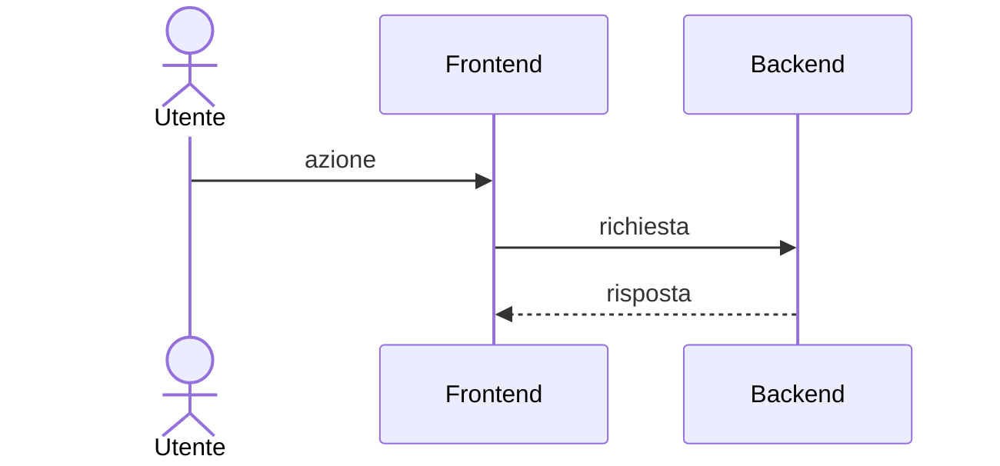

<!--
Modello delle analisi di implementazione. Lo usa /analisi; a mano: nuova nota vuota nella cartella Analisi/ del progetto, poi "Templater: Insert template".
- stato: bozza → in revisione → approvata → implementata | superata (se superata, link alla nuova analisi in "Storico").
- task: ID del task collegato (vuoto se non c'è ancora).
- Una sezione che non serve non si cancella: si scrive "Non applicabile: motivo".
- Distinguere sempre i fatti verificati (con file e riga) dalle ipotesi (marcate "Da verificare").
- Cancellare questo commento quando la nota è compilata.
-->

# <% tp.file.title %>

> [!abstract] In breve
> - **Problema:** cosa non va o cosa manca, in una frase.
> - **Proposta:** la soluzione scelta, in una frase.
> - **Impatto:** aree toccate (es. database, backend, frontend, configurazione).
> - **Stima:** ore totali indicative · **Rischio:** basso / medio / alto.
> - **Da decidere:** quanti punti aperti restano (dettaglio nella sezione 8).

## 1. Contesto e obiettivo

- **Perché:** il bisogno o il problema, chi lo chiede (cliente, team, ticket).
- **Obiettivo:** il risultato atteso, misurabile se possibile.
- **Riferimenti:** ticket, documenti, conversazioni.

## 2. Requisiti

### Funzionali

| #   | Requisito                                     | Priorità |
| --- | --------------------------------------------- | -------- |
| R1  | L'utente può …, e il sistema risponde con …   | Must     |
| R2  |                                               | Should   |

<!-- Priorità MoSCoW: Must, Should, Could, Won't (per ora) -->

### Non funzionali

- Prestazioni, sicurezza e permessi, accessibilità, compatibilità, volumi di dati.

### Fuori ambito

- Cosa questa analisi **non** copre, per evitare equivoci.

## 3. Situazione attuale

Come funziona oggi, con i punti del codice coinvolti.

- `percorso/del/File.ext` — cosa fa e perché conta qui.

### Problemi trovati

| #   | Dove | Problema | Effetto |
| --- | ---- | -------- | ------- |
| P1  |      |          |         |

## 4. Soluzione proposta

### Panoramica

Due o tre frasi: l'idea, e perché risolve i requisiti della sezione 2.

### Modifiche per area

| Area          | Cosa cambia | File / componenti |
| ------------- | ----------- | ----------------- |
| Database      |             |                   |
| Backend       |             |                   |
| Frontend      |             |                   |
| Configurazione |            |                   |

### Flusso

<!-- Facoltativo: un diagramma quando il flusso tra componenti non è ovvio. -->

### Dati e contratti

Nuove tabelle o colonne, modelli, endpoint (metodo, percorso, richiesta, risposta), messaggi di errore.

## 5. Alternative valutate

| Opzione      | Pro | Contro | Scelta     |
| ------------ | --- | ------ | ---------- |
| A — proposta |     |        | ✅          |
| B            |     |        | ❌ perché … |

## 6. Impatti

- **Feature flag / configurazione:** serve un flag? com'è il comportamento con il flag spento?
- **Compatibilità:** dati esistenti, client esistenti, integrazioni.
- **Sicurezza e permessi:** chi può fare cosa, controlli lato server.
- **Testi e traduzioni:** nuovi testi visibili all'utente.
- **Prestazioni:** query, volumi, chiamate in più.
- **Rilascio:** ordine dei passi, script da eseguire, configurazioni per ambiente, rollback.
- **Documentazione:** cosa aggiornare.

## 7. Rischi

| Rischio | Probabilità | Impatto | Mitigazione |
| ------- | ----------- | ------- | ----------- |
|         | bassa       | medio   |             |

## 8. Punti aperti

- [ ] Domanda — a chi chiederla · perché blocca o cosa cambia la risposta.

## 9. Piano di lavoro

Passi ordinati; ognuno può diventare un task del flusso.

| #   | Passo | Stima | Dipende da |
| --- | ----- | ----- | ---------- |
| 1   |       | 2h    | —          |

**Totale:** 0h

## 10. Come verificarlo

- Casi di test (normale, limite, errore) e risultato atteso per ognuno.
- Come provarlo a mano: ambiente, utente, passi.

## 11. Riferimenti

- Documenti, ticket, link al codice, note del vault collegate.

## Storico

- <% tp.date.now("YYYY-MM-DD") %> · prima stesura
